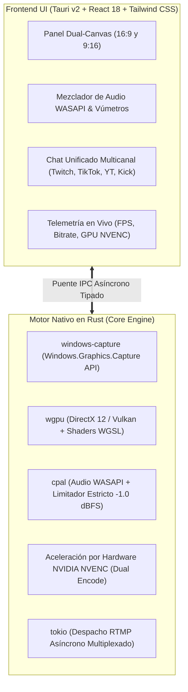

# 🦀 OxideCast Studio

<p align="center">
  
</p>

<p align="center">
  <strong>Suite Broadcast y Grabación de Nueva Generación en Rust y Tauri v2</strong><br/>
  <em>Dual-Canvas simultáneo (16:9 y 9:16), Aceleración por Hardware NVIDIA NVENC Zero-Copy y Chat Unificado Omnicanal.</em>
</p>

<p align="center">
  <a href="https://github.com/yogui-dev/oxidecast/actions"></a>
  <a href="https://github.com/yogui-dev/oxidecast/releases"></a>
  
  
  
  <a href="LICENSE"></a>
</p>

---

## 🇨🇱 Creado en Chile para el Mundo

**OxideCast** nace en Chile (Biobío — Los Ángeles / Concepción) bajo la visión de **Jorge Arias (YoguiDev)** para resolver de forma nativa la mayor limitación técnica que enfrentan los streamers y creadores de contenido contemporáneos: **la necesidad de transmitir simultáneamente a plataformas horizontales tradicionales (YouTube, Twitch, Kick) y plataformas verticales de formato corto (TikTok Live, Instagram Live)** sin duplicar el consumo de hardware ni abrir docenas de programas parásitos.

Toda la documentación técnica, guías operativas, especificaciones y arquitectura están redactadas **en español**, pensadas para que la comunidad hispanohablante y el ecosistema de creadores y desarrolladores latinoamericanos cuenten con una herramienta de nivel broadcast mundial, desarrollada con los más altos estándares de ingeniería de software.

---

## ⚡ ¿Por qué OxideCast? (Frente a OBS Studio Tradicional)

| Característica | OBS Studio Clásico | OxideCast Studio |
| :--- | :--- | :--- |
| **Lienzo de Emisión** | Un solo lienzo fijo 16:9 *(requiere plugins pesados como Aitum para vertical)* | **Dual-Canvas Nativo (16:9 y 9:16 en paralelo)** con sincronización matemática de capas |
| **Consumo de Memoria RAM** | ~200 MB – 350 MB en reposo | **< 80 MB de RAM** *(Núcleo en Rust puro con cero runtime parásito)* |
| **Pipeline de Video** | Copias intermedias de texturas | **Zero-Copy en VRAM** *(Windows Graphics Capture $\rightarrow$ `wgpu` $\rightarrow$ NVENC directo)* |
| **Pausas por Garbage Collector** | N/A (C++) pero con riesgo de memory leaks | **Cero Garbage Collector y Concurrencia Segura** *(Compilado con Rust y el borrow checker)* |
| **Gestión de Chats** | Múltiples ventanas flotantes de navegador que consumen gigabytes | **Chat Unificado Omnicanal** con soporte para ventana flotante desacoplable para 2do monitor |
| **Instalador y Peso** | ~110 – 160 MB | **~15 – 20 MB** *(Instalador NSIS y versión portable autónoma)* |

---

## 🏗️ Arquitectura y Stack Tecnológico

OxideCast está estructurado bajo los principios **SOLID**, **Clean Architecture** y **DIP (Dependency Inversion Principle)**:



- **Motor Gráfico:** [`wgpu`](https://wgpu.rs/) ejecutando sobre DirectX 12 nativo en Windows con composición por shaders WGSL.
- **Captura sin Bloqueos:** `Windows.Graphics.Capture API` de Windows 10/11. Captura videojuegos 3D a máxima tasa de refresco sin inyectar DLLs intrusivas, siendo 100% compatible con juegos con sistemas anti-cheat como Riot Vanguard.
- **Audio DSP de Estudio:** Ingesta de micrófono y sonido del sistema mediante WASAPI loopback con puerta de ruido (*Noise Gate*) y limitador de picos (*Peak Limiter*) calibrado con techo estricto a `-1.0 dBFS` para evitar saturación y distorsión digital.
- **Multistreaming Inteligente:** Duplicación de paquetes NAL en memoria RAM hacia múltiples sockets RTMP en hilos asíncronos de `tokio`, evitando codificar más de una vez por formato de salida.

---

## 🚀 Requisitos y Puesta en Marcha (Desarrollo Local)

### Requisitos del Sistema
- **Sistema Operativo:** Windows 10 (versión 1903+) o Windows 11 (64-bit).
- **Herramientas de Compilación:**
  - [Rust](https://www.rust-lang.org/) (versión 1.80 o superior con toolchain `stable-x86_64-pc-windows-msvc`).
  - [Node.js](https://nodejs.org/) (versión 20+ LTS).
  - [pnpm](https://pnpm.io/) (gestor de paquetes obligatorio).
  - Microsoft Visual Studio C++ Build Tools.

### Instalación y Ejecución

```powershell
# 1. Clonar el repositorio
git clone https://github.com/yogui-dev/oxidecast.git
cd oxidecast

# 2. Instalar dependencias del frontend con pnpm
pnpm install

# 3. Ejecutar suite de pruebas unitarias (TDD)
pnpm test
cargo test --manifest-path src-tauri/Cargo.toml

# 4. Iniciar en modo desarrollo interactivo
pnpm tauri dev
```

---

## 📦 Hoja de Ruta (Roadmap)

- [x] **Fase 0:** Especificación formal de arquitectura de software y diseño visual.
- [ ] **Fase 1 (MVP en curso):**
  - [x] Repositorio público y scaffolding de Tauri v2 + React.
  - [ ] Componente Dual-Canvas responsivo y anclaje reactivo de capas.
  - [ ] Motor de audio DSP (`cpal` + limitador estricto a `-1.0 dBFS`).
  - [ ] Ingesta WGC de pantalla/juegos con fallback automático.
  - [ ] Pipeline `wgpu` con shaders WGSL y doble superficie de renderizado.
  - [ ] Codificación dual NVENC con despacho RTMP asíncrono en `tokio`.
  - [ ] Subsistema de Chat Unificado con soporte desacoplable para segundo monitor.
  - [ ] Empaquetado instalable NSIS y versión portable para Windows.
- [ ] **Fase 2:** Soporte para transiciones Stinger personalizadas y cámara virtual DirectShow.
- [ ] **Fase 3:** Conector de plugins comunitarios en Rust y WebAssembly (Wasm).

---

## 📄 Licencia

Este proyecto se distribuye bajo la licencia **MIT**. Consulta el archivo `LICENSE` para más detalles.

---

<p align="center">
  <strong>OxideCast Studio</strong> • Desarrollado por <a href="https://github.com/yogui-dev">Jorge Arias (YoguiDev)</a><br/>
  Los Ángeles · Concepción, Región del Biobío, Chile 🇨🇱
</p>
