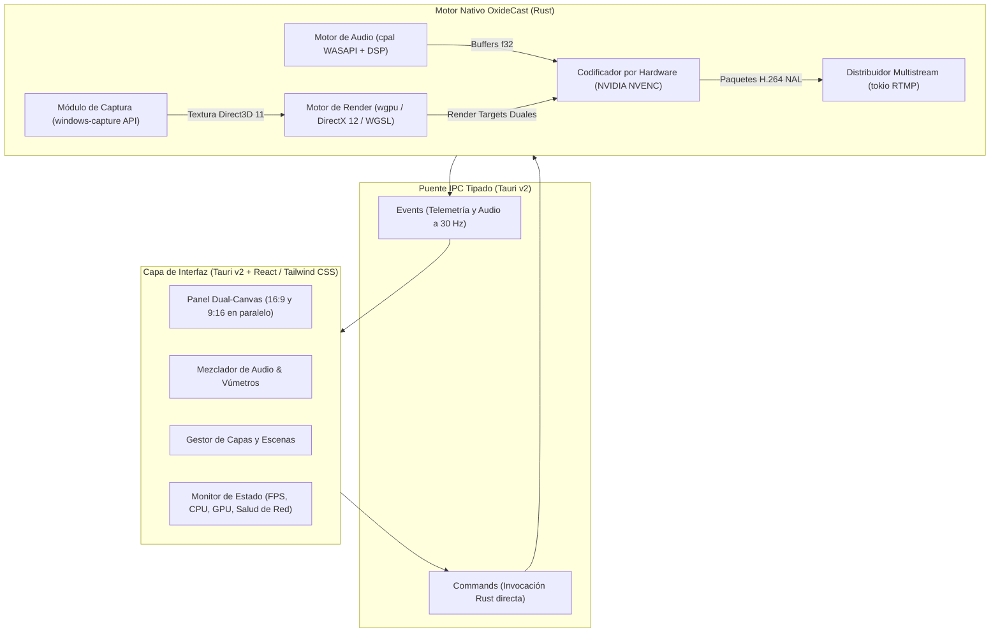

# 🦀 Especificación de Diseño: OxideCast (Live Broadcast Engine)

- **Fecha:** 2026-11-23
- **Proyecto:** OxideCast
- **Autor:** Jorge Arias (YoguiDev)
- **Repositorio:** `https://github.com/yogui-dev/oxidecast`
- **Ubicación Local:** `C:\Proyectos\yoguidev\oxidecast`
- **Estado:** Aprobado / Listo para Planificación de Implementación

---

## 1. Resumen Ejecutivo y Visión

**OxideCast** es una suite de transmisión y grabación en vivo de código abierto diseñada desde cero en **Rust** y **Tauri v2**. Nace para superar las limitaciones estructurales de OBS Studio (lienzos 16:9 rígidos, interfaces pesadas en Qt y sobrecosto al emitir en vertical).

Su propuesta central es el **Streaming Omnicanal Nativo**:
- Permite componer y emitir simultáneamente en formato horizontal (16:9 para YouTube, Twitch, Kick, Facebook) y vertical (9:16 para TikTok Live, Instagram Live).
- Todo mediante un pipeline de alto rendimiento **Zero-Copy en GPU**, acelerado por **NVIDIA NVENC** y con una huella de memoria en reposo inferior a **80 MB de RAM**.

---

## 2. Arquitectura de Software y Componentes

El sistema se estructura en dos capas principales comunicadas mediante el puente IPC asíncrono y tipado de Tauri v2:



### Componentes del Core en Rust (`src-tauri/src/`)
1. **`engine::capture`:** Ingesta de video de ventanas y pantallas completas mediante la API moderna `Windows.Graphics.Capture`. Ingesta de webcams mediante `windows-rs` / MediaFoundation.
2. **`engine::render`:** Motor gráfico basado en `wgpu`. Compone las capas visuales mediante shaders en WGSL y genera dos superficies de renderizado paralelas (`1920×1080` y `1080×1920`).
3. **`engine::audio`:** Captura de baja latencia con `cpal` (WASAPI Loopback para sonido de juegos/sistema + entrada de micrófono). Cadena DSP: Puerta de Ruido y Limitador de Picos a `-1.0 dBFS`.
4. **`engine::encoder`:** Interfaz directa hacia el chip de silicio NVIDIA NVENC (GPU RTX 4050). Ejecuta exactamente dos sesiones de codificación por hardware en paralelo (una horizontal y una vertical).
5. **`engine::network`:** Motor asíncrono en `tokio` que duplica los paquetes de video comprimidos en memoria y los despacha mediante sockets TCP/RTMP hacia los destinos configurados.

### Componentes de la Interfaz (`src/`)
1. **`components/DualCanvas`:** Muestra en tiempo real ambos lienzos (16:9 a la izquierda, 9:16 a la derecha) con soporte para arrastrar, redimensionar y alinear capas.
2. **`components/AudioMixer`:** Control individual de volumen por fuente, medidores de nivel (dBFS) y botón de mute.
3. **`components/StreamControls`:** Botones de inicio/parada de transmisión y grabación, con indicadores de salud de conexión por plataforma.

---

## 3. Pipeline de Renderizado y Dual-Canvas (Zero-Copy)

### Sincronización Inteligente de Capas (Smart Layout Anchor)
Cuando el usuario ajusta una capa en el lienzo 16:9, OxideCast aplica automáticamente reglas de anclaje relativas para el lienzo 9:16:
- **Cámara:** Anclada por defecto en la parte superior del formato vertical.
- **Juego:** Centrado automáticamente con escalado proporcional sin deformación de aspecto.
- **Chat / Overlays:** Anclados en el tercio inferior del formato vertical.
- El usuario puede desacoplar el comportamiento si desea personalizar las coordenadas de cada formato de manera independiente.

### Ciclo de Cuadro a 60 FPS (Zero-Copy VRAM)
```
[Juego / Pantalla] 
       │ (DirectX 11 Surface via WGC)
       ▼
[wgpu Direct Texture Binding] ──> [WGSL Composition Shader]
                                          │
                  ┌───────────────────────┴───────────────────────┐
                  ▼                                               ▼
     [Target 16:9 (1920x1080)]                       [Target 9:16 (1080x1920)]
                  │                                               │
                  ▼                                               ▼
         [NVENC H.264 Encoder A]                         [NVENC H.264 Encoder B]
                  │                                               │
                  ▼                                               ▼
       [Socket RTMP YouTube/Twitch]                     [Socket RTMP TikTok/Insta]
```
No existe transferencia de píxeles hacia la memoria RAM del sistema. El procesamiento reside 100% en la VRAM de la GPU NVIDIA RTX 4050.

---

## 4. Pipeline de Audio y Procesamiento DSP

- **Frecuencia de Muestreo:** 48.000 Hz estéreo con muestras en coma flotante de 32 bits (`f32`).
- **Cadena de Filtros en Serie:**
  1. **Atenuación / Ganancia:** Ajuste de volumen lineal pre-filtro.
  2. **Puerta de Ruido (Noise Gate):** Umbral configurable (por defecto `-32 dBFS`) con tiempos de ataque (10 ms) y decaimiento (100 ms).
  3. **Limitador de Picos (Peak Limiter):** Techo estricto en `-1.0 dBFS` con curva soft-knee para prevenir distorsión digital (*clipping*).
- **Codificación de Audio:** AAC a 160 kbps por canal de salida.

---

## 5. Distribución y Empaquetado para Windows

La distribución de OxideCast se compila con `tauri-cli v2` y produce:
1. **Instalador Oficial (`.exe` NSIS):** Instalador estándar con creación de accesos directos y desinstalador limpio.
2. **Versión Portable (`.exe` Standalone):** Binario único sin instalación en el sistema operativo.
3. **Actualizador Automático Integrado:** Módulo `tauri-plugin-updater` sincronizado con las publicaciones de releases en `https://github.com/yogui-dev/oxidecast/releases`.
4. **Huella de Peso:** Instalador final de ~15 a 20 MB.

---

## 6. Matriz de Resiliencia y Manejo de Errores

| Incidente / Fallo | Detección Técnica | Acción Automática de Recuperación |
| :--- | :--- | :--- |
| **Cierre abrupto del videojuego** | `GraphicsCaptureItem::Closed` | Conmuta inmediatamente a placa de reserva (*"Esperando juego..."*) en 16 ms sin cortar la transmisión. |
| **Corte de red RTMP** | Error en socket TCP / EWOULDBLOCK | Retiene últimos 3s en búfer circular y ejecuta reconexión automática en hilo de fondo (1s, 2s, 4s). |
| **Desconexión de Micrófono USB** | Evento de desconexión en stream `cpal` | Pasa a silencio temporal y reconecta al micrófono predeterminado del sistema. |
| **Sobrecarga de GPU (>95%)** | Contador de frames descartados en NVENC | Reduce el framerate de la vista previa en la UI (de 60 a 30 FPS) para priorizar la salida de transmisión. |

---

## 7. Estrategia de Pruebas y Control de Calidad

1. **Pruebas Unitarias de Rust (`cargo test`):**
   - Cobertura matemática del limitador de picos y puerta de ruido.
   - Verificación de empaquetado de encabezados FLV/RTMP.
   - Serialización de perfiles de usuario en JSON.
2. **Pruebas de Renderizado Offscreen:**
   - Render headless en `wgpu` comparando imágenes generadas contra un hash de referencia para validar ausencia de corrupción gráfica.
3. **Pruebas de Frontend (Vitest):**
   - Verificación de reglas matemáticas de redimensionamiento de los lienzos y anclaje reactivo de capas.
4. **Prueba de Resistencia (Stress Test):**
   - Transmisión continua de 30 minutos a endpoints de prueba locales verificando que el consumo de memoria permanezca estable (<80 MB).
